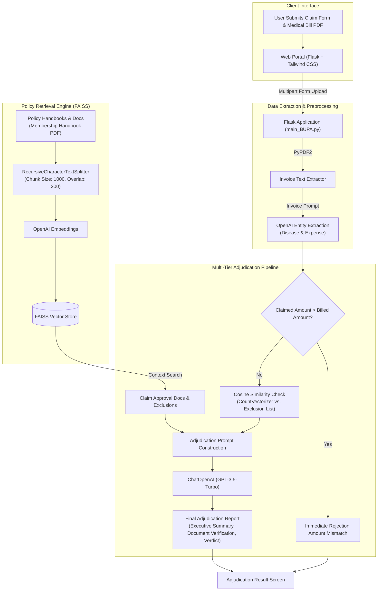

# ClaimTrackr: AI-Powered Automated Health Insurance Claim Processing System

An intelligent, end-to-end Generative AI platform designed to automate health insurance claim validation, policy compliance verification, fraud detection, and adjudication reporting. Built using **LangChain**, **OpenAI GPT-4o-mini**, **FAISS Vector Store**, and **Flask**.

[](https://render.com/deploy?repo=https://github.com/Aadarsh-x54/claimtrackr)

---

## Executive Overview

Manual health insurance claim adjudication is traditionally a slow, error-prone, and labor-intensive process. Adjusters must manually parse medical bills, compare claims against lengthy policy handbooks (often 100+ pages), cross-reference general exclusions, and verify that billed amounts match claimed totals.

**ClaimTrackr** transforms this workflow into an automated AI pipeline:
1. **Automated Bill & Document Extraction**: Extracts patient data, diagnostic statements, and financial totals directly from uploaded medical invoices.
2. **Semantic Knowledge Retrieval (RAG)**: Indexes policy rules, membership handbooks, and terms via FAISS vector embeddings to extract relevant policy clauses on demand.
3. **Multi-Stage Adjudication Logic**:
   - **Financial Sanity Check**: Verifies that the claimed reimbursement amount does not exceed the billed hospital total.
   - **Exclusion Screening**: Uses semantic cosine similarity against high-risk policy exclusion categories (e.g., pre-existing conditions, specified chronic illnesses).
   - **LLM-Based Policy Verification**: Evaluates compliance using OpenAI LLM and formats a structured, audit-ready adjudication report.

---

## System Architecture



---

## Key Features

- **Document Understanding & Parsing**: Extracts line items, diagnostic conditions, and bill amounts directly from unstructured hospital invoices using PyPDF2 and LLM entity extraction.
- **RAG-Powered Policy Verification**: Ingests organizational membership handbooks (such as Bupa global policies) and queries required document criteria and policy exclusion terms in real time.
- **Automated Fraud & Sanity Guards**:
  - Catches inflated reimbursement requests where `Claim Amount > Billed Expense`.
  - Screens diagnoses using Scikit-Learn vectorization against excluded condition lists.
- **Structured Executive Reports**: Generates clear, auditable outcomes including:
  - Acceptance / Rejection verdict
  - Maximum approved settlement amount
  - Information completeness verification
  - Fraud indicators & document summary
- **Clean Responsive UI**: Modern frontend built with Tailwind CSS for seamless claim submissions and instant results.

---

## Project Structure

```text
project12/
├── BillExtraction/               # Invoice entity extraction module
│   ├── Bills/                    # Sample test bills (Alzheimer, Bodyache, HIV, etc.)
│   │   ├── Alzheimer.pdf
│   │   ├── Bodyache.pdf
│   │   └── HIV.pdf
│   ├── bill_extraction.py        # Standalone bill parser script
│   └── config.yaml               # Extraction configuration
├── documents/                    # Insurance policy reference documents
│   ├── MembershipHandbook.pdf    # Master policy terms & exclusions
│   ├── MembershipHandbook-22-23.pdf
│   ├── Patient Information.pdf
│   ├── Worldwide Assistance Programme.pdf
│   └── med_bill1.pdf             # Sample consultation invoice
├── faiss_index/                  # Pre-computed FAISS vector index & metadata
│   ├── index.faiss
│   └── index.pkl
├── new_faiss/                    # Auxiliary vector index
│   ├── index.faiss
│   └── index.pkl
├── templates/                    # Web interface HTML templates
│   ├── index.html                # Claim submission portal
│   ├── result.html               # Audit report & adjudication result
│   └── trial.html                # Component test template
├── .env.example                  # Environment variable template
├── .gitignore                    # Git exclusions
├── main_BUPA.py                  # Primary Flask application & adjudication engine
├── README.md                     # Project documentation
├── requirements.txt              # Production Python dependencies
└── run.py                        # Convenient application launcher
```

---

## Tech Stack

| Component | Technology | Description |
|---|---|---|
| **Language** | Python 3.10+ | Core language |
| **Web Framework** | Flask | Web server, routing, and form processing |
| **LLM & Embeddings** | OpenAI GPT-3.5-Turbo, OpenAIEmbeddings | Contextual reasoner & dense embeddings |
| **Vector Database** | FAISS (faiss-cpu) | Fast similarity search for policy chunks |
| **Framework** | LangChain | Prompt templates, document loaders, chains |
| **NLP & Matching** | Scikit-learn, CountVectorizer | Cosine similarity for disease exclusion checks |
| **Document Parsing** | PyPDF2, pdf2image | PDF text extraction and processing |
| **Styling** | Tailwind CSS | Clean, responsive UI |

---

## Getting Started

### 1. Prerequisites

- Python 3.10 or higher
- An OpenAI API Key ([platform.openai.com](https://platform.openai.com/api-keys))

### 2. Clone / Setup Project

Open a terminal in the project directory:

```bash
cd project12
```

### 3. Create a Virtual Environment

It is recommended to use an isolated Python virtual environment:

```bash
# Windows
python -m venv venv
venv\Scripts\activate

# macOS / Linux
python3 -m venv venv
source venv/bin/activate
```

### 4. Install Dependencies

Install all required packages from `requirements.txt`:

```bash
pip install -r requirements.txt
```

### 5. Configure Environment Variables

Copy the provided `.env.example` file to `.env`:

```bash
cp .env.example .env
```

Open `.env` and insert your OpenAI API key:

```env
OPENAI_API_KEY=sk-your-openai-key-here
PORT=8081
```

---

## Running the Application

### Option A: Using the Launcher (Recommended)

```bash
python run.py
```

### Option B: Running Directly via Flask

```bash
python main_BUPA.py
```

Once started, open your web browser and navigate to:
```text
http://localhost:8081
```

---

## How to Test & Verify Claims

Use the sample files provided in `BillExtraction/Bills/` and `documents/`:

| Test Scenario | Sample Bill | Inputs | Expected Result |
|---|---|---|---|
| **Scenario 1: Valid Claim** | `BillExtraction/Bills/Bodyache.pdf` | Total Amount: `< billed amount`<br>Reason: Routine consultation | **Accepted**: Generates complete approval summary with approved amount. |
| **Scenario 2: Policy Exclusion** | `BillExtraction/Bills/Alzheimer.pdf` or `HIV.pdf` | Total Amount: Valid<br>Reason: Related to condition | **Rejected**: Flagged by exclusion matching algorithm. |
| **Scenario 3: Over-Claim Attempt** | `documents/med_bill1.pdf` | Total Amount: Exceeds invoice total | **Rejected**: Financial check fails ("Claimed amount is greater than billed amount"). |

---

## Standalone Bill Extraction Utility

To inspect the extraction logic on an isolated invoice without starting the web server:

```bash
python BillExtraction/bill_extraction.py
```

This extracts the primary diagnosis (`disease`) and invoiced total (`expense`) in clean JSON format.

---

## Adjudication Workflow Details

1. **Document Loader**:
   Loads the policy handbook PDFs from the `documents/` directory using LangChain's `DirectoryLoader` and `PyPDFLoader`.
2. **Text Chunking**:
   Splits large documents into manageable segments of 1000 characters with 200-character overlap using `RecursiveCharacterTextSplitter`.
3. **Vector Store**:
   Computes embeddings using `OpenAIEmbeddings` and builds/queries an in-memory or persisted `FAISS` index.
4. **Context Gathering**:
   Retrieves exact policy terms regarding required documents and general exclusions via semantic search.
5. **Adjudication Evaluation**:
   Executes `LLMChain` with structured prompt constraints to produce an audit trail for compliance officers.

---

## License

This project is developed for educational and portfolio demonstration purposes. All rights reserved.
